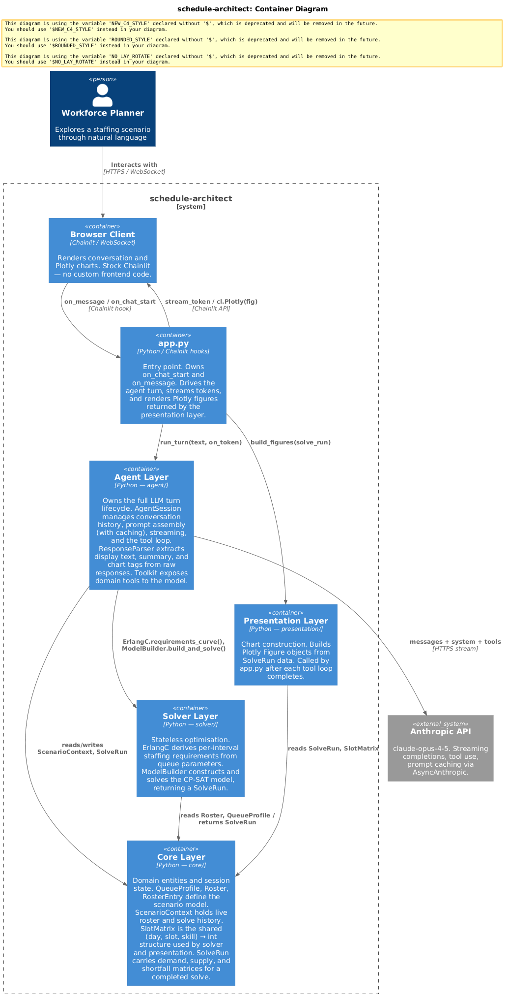

# Schedule Architect

A Claude agent that works through call center staffing problems with a user. The user directs changes in plain English; the agent drives an Erlang C demand model and a CP-SAT scheduling model, then interprets the results and suggests what to try next.

A work in progress, built layer by layer. The chat interface and the solver each work on their own; I'm in the middle of reconnecting them after a solver rewrite, so **the app does not run end to end yet** (see [Status](#status)).

---

## What it does

The app opens on a pre-loaded scenario: a retail call center with six queues (Account Services, Online Orders, Photo, Floral, Bakery, Escalations) and a 34-agent roster with deliberate coverage gaps. The agent walks the user through a first solve, points out where coverage falls short, suggests roster changes, and re-solves to compare runs.

---

## How it works



Chainlit handles the browser and streams tokens. Each user message starts an agent turn: the agent can call tools to change the roster, run the solver, or check status, and keeps calling the model until it has a final reply. The solver converts queue volumes into per-interval staffing requirements with Erlang C, then builds a CP-SAT model that assigns start times, breaks, work weeks, and skill blocks to minimize shortfall.

| Folder | Role |
|---|---|
| `app.py` | Chainlit hooks: start a session, stream tokens to the browser |
| `agent/` | Conversation history, prompt assembly, streaming, tool loop, response parsing |
| `core/` | Scenario state, solve history, shared Polars schemas, the default scenario |
| `solver/` | Erlang C requirements and the CP-SAT schedule model |
| `presentation/` | Plotly chart builders |

---

## Design notes

Conversation-management patterns change quickly; these notes describe the choices as built.

**Staged prompt, ordered for caching.** The session is a guided walkthrough, so the system prompt is assembled as: overview → scenario → final-stage guidance → middle-stage → beginning-stage. The agent always sees where the session is headed, and as the user progresses, finished stages drop off the end. What remains is an unchanged prefix, so it's cached; only a short block of recent-solve context after it changes each turn.

**One turn, one loop.** An earlier version used an event queue that executed commands in arrival order; it didn't hold up in practice. The current design is a single loop per user turn: stream a response, and if the model stops to call tools, run them, append the results, and stream again until it finishes. Tradeoff: tools run synchronously inside the async loop, so a long solve blocks the server while it runs. Fine for a demo; a thread offload would fix it.

**Named solve history.** `ScenarioContext` holds the current roster and the last five solves. The agent names each run when it calls the solver ("Initial Run", "Add 2 Photo + 2 Floral"), and those names go into the per-turn prompt, so the agent and user can compare runs by name.

**Charts as inline tags.** The agent places a `<<chart …>>` tag where a chart belongs in its reply. `ResponseParser` reads the token stream character by character, holds back anything inside `<< >>` (tags can be split across tokens), and passes everything else to the UI immediately. When the reply finishes, the app renders each chart with Chainlit's Plotly element at the position the agent chose. A `<<summary>>` tag works the same way: only the summary is kept in conversation history.

**Model written with dfor.** The CP-SAT model is built with [dfor](https://github.com/neon-tetra/dfor), so variables and constraints are created as Polars pipelines over named data. The model reads like data transformation code, and every constraint carries a name, so infeasibility diagnosis (QuickXplain) reports conflicts in scheduling terms instead of variable indices.

---

## Status

The interface and the solver were built and tested separately, and have not worked together end to end since the solver rewrite.

Working on their own: streamed chat, the tool loop, staged and cached prompts, solve history, the response parser, Erlang C demand curves, and the CP-SAT model build and solve.

Being reconnected (this is the current work):
- Linking the rewritten solver back to the app: `solver/scheduler.py` currently imports a shift-pattern helper that `solver/shift_patterns.py` no longer defines, and solver output isn't yet mapped onto `SolveRun`, so solves don't land in session history
- The `define_roster` tool handler
- Chart rendering in the conversation; a baseline suite of Plotly visualizations for the agent to draw from is in progress in `presentation/`

Next: a small library of named, parameterized constraint templates the agent can select and configure at runtime (e.g. *"at least one Photo agent starting at 8am every day"*).

---

## Running it

The full app can't be run yet, for the reasons above. The setup below is for working on the code:

Requires Python 3.12.

```bash
git clone https://github.com/neon-tetra/schedule-architect.git
cd schedule-architect
python -m venv .venv
source .venv/bin/activate          # Windows: .venv\Scripts\activate
pip install -r requirements.txt
pip install git+https://github.com/neon-tetra/dfor
```

`pytest` runs the smoke tests. Those that need the solver are skipped when it can't be imported.

Once the integration is finished, the app will run with `chainlit run app.py` after copying `.env.example` to `.env` and adding an `ANTHROPIC_API_KEY`.

---

## License

MIT. See [LICENSE](LICENSE).
